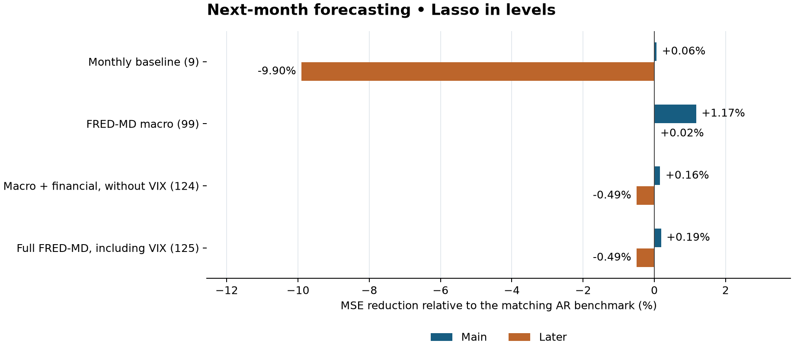
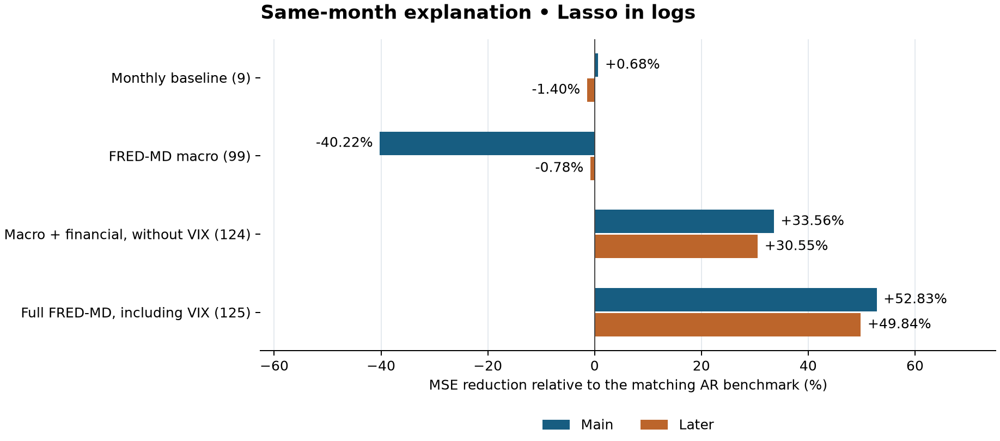
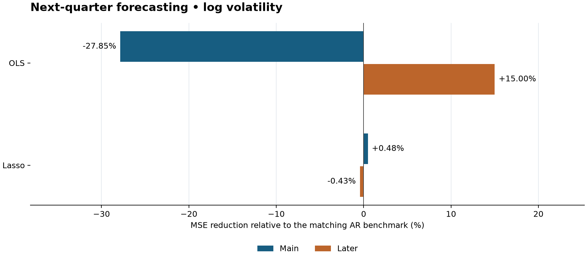

# Detailed results: volatility forecasting and explanation

Generated 2026-10-12T09:52:10+00:00 from saved full evaluations. All 238 canonical comparison rows were independently reconciled to prediction errors. Smoke runs and derived best-row inventories are excluded. [Project overview](project_overview.md) explains the construction and assumptions; [interactive page](results.html) provides filters, charts and source links.

## 1. How to read the results

Every percentage is the reduction in MSE against that experiment's matching AR benchmark: positive is better, negative is worse. For forecasts this is out-of-sample R-squared relative to AR; for same-month explanation it is held-out explanatory performance relative to AR. It is not conventional R-squared against the sample mean. Baselines are displayed as zero reduction even where older CSVs leave their own R-squared blank.

Evaluate comparisons within the same experiment, dates and response scale. Raw log MSE cannot be compared with level MSE. Original rolling, Paye, FRED-MD and quarterly samples differ in dates, window sizes, timing and eligible predictors. The later period is retrospective robustness. Reported differences are sample estimates; this project has not supplied significance tests or confidence intervals.

| Question | Scale | Lasso predictor pool | Main error reduction | Later error reduction |
| --- | --- | --- | --- | --- |
| FRED-MD forecast | level | Monthly baseline (9) | +0.061% | -9.899% |
| FRED-MD forecast | level | FRED-MD macro (99) | +1.171% | +0.016% |
| FRED-MD forecast | level | Macro + financial, without VIX (124) | +0.161% | -0.494% |
| FRED-MD forecast | level | Full FRED-MD, including VIX (125) | +0.188% | -0.494% |
| Same-month explanation | log | Monthly baseline (9) | +0.684% | -1.399% |
| Same-month explanation | log | FRED-MD macro (99) | -40.218% | -0.778% |
| Same-month explanation | log | Macro + financial, without VIX (124) | +33.562% | +30.550% |
| Same-month explanation | log | Full FRED-MD, including VIX (125) | +52.826% | +49.845% |
| Quarterly forecast | log | Quarterly baseline (9) | +0.481% | -0.428% |

The broad monthly forecast gains are modest and do not persist consistently later. The macro-only pool gives about 1.17% lower main-period MSE but about 0.016% lower later MSE, effectively a tie in practical terms without further uncertainty analysis. Same-month financial pools show much larger gains in both periods. Quarterly Lasso's small main log advantage does not persist later or in levels.

## 2. Original fixed and 360-month rolling models

The fixed model has 240 forecast origins, January 2001–December 2020. It fits once through December 2000. The 360-month rolling model has 229 saved origins, December 2001–December 2020, because the complete-case history limits the first possible window. Both use six AR terms and ten macro predictors, including the carried-forward quarterly GDP variable. Targets are next-month annualized volatility in levels.

| Specification | Model | Scale | Period | N | MSE | RMSE | Error reduction vs AR |
| --- | --- | --- | --- | --- | --- | --- | --- |
| Original fixed | AR | level | Saved evaluation | 240 | 0.007785 | 0.088235 | +0.000% |
| Original fixed | OLS | level | Saved evaluation | 240 | 0.008406 | 0.091686 | -7.977% |
| Original fixed | Lasso | level | Saved evaluation | 240 | 0.007785 | 0.088235 | +0.000% |
| Original rolling | AR | level | Saved evaluation | 229 | 0.008191 | 0.090504 | +0.000% |
| Original rolling | OLS | level | Saved evaluation | 229 | 0.008534 | 0.092382 | -4.193% |
| Original rolling | Lasso | level | Saved evaluation | 229 | 0.008194 | 0.090523 | -0.042% |

Fixed Lasso collapses to the AR benchmark; joint OLS raises MSE by about 7.98%. Rolling Lasso is almost identical to AR, with a 0.042% increase in MSE, while OLS raises MSE by about 4.19%. These two designs do not indicate meaningful added forecast value from this ten-variable set.

Sources: [fixed_model_comparison.csv](../../output/tables/fixed_model_comparison.csv); [rolling_model_comparison.csv](../../output/tables/rolling_model_comparison.csv).

## 3. Paye individual predictors and the joint model

All these fits use a common 240-month rolling sample and 228 origins in January 2001–December 2019. Net payout yield's coverage causes that endpoint even for other individual predictors. Eight extra predictors are available; `exret` is missing. Dfr is sourced from annual observations, so it should not be interpreted as a new monthly bond-return signal.

| Specification | Model | Scale | Period | N | MSE | RMSE | Error reduction vs AR |
| --- | --- | --- | --- | --- | --- | --- | --- |
| AR(6) | AR | level | 2001–2019 | 228 | 0.005173 | 0.071926 | +0.000% |
| Commercial-paper spread | OLS | level | 2001–2019 | 228 | 0.005282 | 0.072675 | -2.093% |
| Commercial-paper spread | Lasso | level | 2001–2019 | 228 | 0.005187 | 0.072023 | -0.269% |
| Annual default-return spread | OLS | level | 2001–2019 | 228 | 0.005320 | 0.072940 | -2.838% |
| Annual default-return spread | Lasso | level | 2001–2019 | 228 | 0.005171 | 0.071906 | +0.056% |
| Default yield spread | OLS | level | 2001–2019 | 228 | 0.005291 | 0.072739 | -2.273% |
| Default yield spread | Lasso | level | 2001–2019 | 228 | 0.005177 | 0.071955 | -0.078% |
| Industrial-production growth | OLS | level | 2001–2019 | 228 | 0.005271 | 0.072603 | -1.890% |
| Industrial-production growth | Lasso | level | 2001–2019 | 228 | 0.005180 | 0.071969 | -0.119% |
| IP growth volatility | OLS | level | 2001–2019 | 228 | 0.005279 | 0.072656 | -2.038% |
| IP growth volatility | Lasso | level | 2001–2019 | 228 | 0.005170 | 0.071906 | +0.057% |
| Net payout yield | OLS | level | 2001–2019 | 228 | 0.005223 | 0.072272 | -0.964% |
| Net payout yield | Lasso | level | 2001–2019 | 228 | 0.005175 | 0.071939 | -0.034% |
| PPI inflation volatility | OLS | level | 2001–2019 | 228 | 0.005365 | 0.073244 | -3.698% |
| PPI inflation volatility | Lasso | level | 2001–2019 | 228 | 0.005213 | 0.072201 | -0.765% |
| Term spread | OLS | level | 2001–2019 | 228 | 0.005233 | 0.072338 | -1.148% |
| Term spread | Lasso | level | 2001–2019 | 228 | 0.005197 | 0.072090 | -0.455% |

| Specification | Model | Scale | Period | N | MSE | RMSE | Error reduction vs AR |
| --- | --- | --- | --- | --- | --- | --- | --- |
| AR(6) | AR | level | 2001–2019 | 228 | 0.005173 | 0.071926 | +0.000% |
| Eight available Paye predictors | OLS | level | 2001–2019 | 228 | 0.006023 | 0.077610 | -16.428% |
| Eight available Paye predictors | Lasso | level | 2001–2019 | 228 | 0.005172 | 0.071919 | +0.021% |

The largest individual Lasso gains are IP volatility at about 0.057% and the annual default-return spread at about 0.056%. Every individual OLS fit is worse than AR. Joint Lasso improves MSE by about 0.021%; joint OLS worsens it by 16.43%. Lasso mainly protects the AR specification from the instability of adding predictors, rather than delivering a substantial accuracy gain.

Sources: [paye_monthly_individual_model_comparison.csv](../../output/tables/paye_monthly_individual_model_comparison.csv); [paye_monthly_kitchen_sink_model_comparison.csv](../../output/tables/paye_monthly_kitchen_sink_model_comparison.csv).

## 4. Paye batch: blocks and penalty grids

| Specification | Model | Scale | Period | N | MSE | RMSE | Error reduction vs AR | Alpha grid |
| --- | --- | --- | --- | --- | --- | --- | --- | --- |
| all_available | Lasso | level | 1993–2010 | 216 | 0.004460 | 0.066783 | +0.420% | moderate_1e-4_1e0 |
| credit | Lasso | level | 2001–2019 | 228 | 0.005167 | 0.071880 | +0.130% | strong_1e-3_1e0 |

The best saved Lasso configuration for 1993–2010 is the all-available block with the moderate grid, reducing MSE by about 0.420%. The best 2001–2019 configuration is the credit block with the stronger grid, reducing MSE by about 0.13%. Both are small. Their ranking is retrospective across seven blocks and two alpha grids, not performance of a single prespecified winner on a fresh test.

The blocks are best_individuals (dfy, ipvol, npy), best_individuals_plus_ip, credit (cp, dfr, dfy), real_activity (ip, ipvol, ppivol), return_payout (npy only because exret is absent), credit_plus_activity, and all_available. All use 240-month windows. Repeated AR rows below are the same benchmark carried into each block comparison, not distinct models. The moderate grid spans 10⁻⁴–1; the stronger grid spans 10⁻³–1, each with 200 values.

| Specification | Model | Scale | Period | N | MSE | RMSE | Error reduction vs AR | Alpha grid |
| --- | --- | --- | --- | --- | --- | --- | --- | --- |
| credit | Lasso | level | 2001–2019 | 228 | 0.005167 | 0.071880 | +0.130% | strong_1e-3_1e0 |
| credit | Lasso | level | 2001–2019 | 228 | 0.005167 | 0.071883 | +0.122% | moderate_1e-4_1e0 |
| all_available | Lasso | level | 2001–2019 | 228 | 0.005172 | 0.071919 | +0.022% | moderate_1e-4_1e0 |
| credit_plus_activity | Lasso | level | 2001–2019 | 228 | 0.005173 | 0.071921 | +0.015% | strong_1e-3_1e0 |
| credit_plus_activity | Lasso | level | 2001–2019 | 228 | 0.005173 | 0.071923 | +0.010% | moderate_1e-4_1e0 |
| all_available | Lasso | level | 2001–2019 | 228 | 0.005173 | 0.071923 | +0.008% | strong_1e-3_1e0 |
| best_individuals | Lasso | level | 2001–2019 | 228 | 0.005173 | 0.071926 | +0.000% | moderate_1e-4_1e0 |
| best_individuals | Lasso | level | 2001–2019 | 228 | 0.005174 | 0.071929 | -0.008% | strong_1e-3_1e0 |
| best_individuals_plus_ip | Lasso | level | 2001–2019 | 228 | 0.005174 | 0.071934 | -0.020% | moderate_1e-4_1e0 |
| best_individuals_plus_ip | Lasso | level | 2001–2019 | 228 | 0.005175 | 0.071934 | -0.022% | strong_1e-3_1e0 |
| return_payout | Lasso | level | 2001–2019 | 228 | 0.005175 | 0.071938 | -0.033% | moderate_1e-4_1e0 |
| return_payout | Lasso | level | 2001–2019 | 228 | 0.005175 | 0.071939 | -0.034% | strong_1e-3_1e0 |
| real_activity | Lasso | level | 2001–2019 | 228 | 0.005180 | 0.071969 | -0.118% | strong_1e-3_1e0 |
| real_activity | Lasso | level | 2001–2019 | 228 | 0.005180 | 0.071971 | -0.123% | moderate_1e-4_1e0 |
| return_payout | OLS | level | 2001–2019 | 228 | 0.005223 | 0.072272 | -0.964% |  |
| best_individuals | OLS | level | 2001–2019 | 228 | 0.005303 | 0.072820 | -2.499% |  |
| best_individuals_plus_ip | OLS | level | 2001–2019 | 228 | 0.005351 | 0.073148 | -3.425% |  |
| credit_plus_activity | OLS | level | 2001–2019 | 228 | 0.005535 | 0.074400 | -6.996% |  |
| real_activity | OLS | level | 2001–2019 | 228 | 0.005541 | 0.074439 | -7.108% |  |
| credit | OLS | level | 2001–2019 | 228 | 0.005549 | 0.074490 | -7.254% |  |
| all_available | OLS | level | 2001–2019 | 228 | 0.006023 | 0.077610 | -16.428% |  |
| best_individuals | AR | level | 2001–2019 | 228 | 0.005173 | 0.071926 | +0.000% |  |
| best_individuals_plus_ip | AR | level | 2001–2019 | 228 | 0.005173 | 0.071926 | +0.000% |  |
| credit | AR | level | 2001–2019 | 228 | 0.005173 | 0.071926 | +0.000% |  |
| real_activity | AR | level | 2001–2019 | 228 | 0.005173 | 0.071926 | +0.000% |  |
| return_payout | AR | level | 2001–2019 | 228 | 0.005173 | 0.071926 | +0.000% |  |
| credit_plus_activity | AR | level | 2001–2019 | 228 | 0.005173 | 0.071926 | +0.000% |  |
| all_available | AR | level | 2001–2019 | 228 | 0.005173 | 0.071926 | +0.000% |  |
| all_available | Lasso | level | 1993–2010 | 216 | 0.004460 | 0.066783 | +0.420% | moderate_1e-4_1e0 |
| all_available | Lasso | level | 1993–2010 | 216 | 0.004461 | 0.066789 | +0.402% | strong_1e-3_1e0 |
| best_individuals | Lasso | level | 1993–2010 | 216 | 0.004480 | 0.066936 | -0.036% | moderate_1e-4_1e0 |
| return_payout | Lasso | level | 1993–2010 | 216 | 0.004481 | 0.066937 | -0.040% | moderate_1e-4_1e0 |
| return_payout | Lasso | level | 1993–2010 | 216 | 0.004481 | 0.066937 | -0.041% | strong_1e-3_1e0 |
| best_individuals | Lasso | level | 1993–2010 | 216 | 0.004481 | 0.066939 | -0.045% | strong_1e-3_1e0 |
| best_individuals_plus_ip | Lasso | level | 1993–2010 | 216 | 0.004482 | 0.066946 | -0.068% | moderate_1e-4_1e0 |
| real_activity | Lasso | level | 1993–2010 | 216 | 0.004482 | 0.066948 | -0.073% | strong_1e-3_1e0 |
| best_individuals_plus_ip | Lasso | level | 1993–2010 | 216 | 0.004482 | 0.066948 | -0.074% | strong_1e-3_1e0 |
| real_activity | Lasso | level | 1993–2010 | 216 | 0.004482 | 0.066950 | -0.080% | moderate_1e-4_1e0 |
| credit_plus_activity | Lasso | level | 1993–2010 | 216 | 0.004500 | 0.067083 | -0.478% | moderate_1e-4_1e0 |
| credit_plus_activity | Lasso | level | 1993–2010 | 216 | 0.004501 | 0.067090 | -0.498% | strong_1e-3_1e0 |
| return_payout | OLS | level | 1993–2010 | 216 | 0.004530 | 0.067303 | -1.138% |  |
| credit | Lasso | level | 1993–2010 | 216 | 0.004532 | 0.067318 | -1.181% | strong_1e-3_1e0 |
| credit | Lasso | level | 1993–2010 | 216 | 0.004534 | 0.067332 | -1.225% | moderate_1e-4_1e0 |
| best_individuals | OLS | level | 1993–2010 | 216 | 0.004682 | 0.068425 | -4.536% |  |
| best_individuals_plus_ip | OLS | level | 1993–2010 | 216 | 0.004723 | 0.068721 | -5.443% |  |
| real_activity | OLS | level | 1993–2010 | 216 | 0.004888 | 0.069917 | -9.147% |  |
| credit_plus_activity | OLS | level | 1993–2010 | 216 | 0.004959 | 0.070421 | -10.726% |  |
| credit | OLS | level | 1993–2010 | 216 | 0.005055 | 0.071100 | -12.871% |  |
| all_available | OLS | level | 1993–2010 | 216 | 0.005604 | 0.074858 | -25.119% |  |
| best_individuals | AR | level | 1993–2010 | 216 | 0.004479 | 0.066924 | +0.000% |  |
| best_individuals_plus_ip | AR | level | 1993–2010 | 216 | 0.004479 | 0.066924 | +0.000% |  |
| credit | AR | level | 1993–2010 | 216 | 0.004479 | 0.066924 | +0.000% |  |
| real_activity | AR | level | 1993–2010 | 216 | 0.004479 | 0.066924 | +0.000% |  |
| return_payout | AR | level | 1993–2010 | 216 | 0.004479 | 0.066924 | +0.000% |  |
| credit_plus_activity | AR | level | 1993–2010 | 216 | 0.004479 | 0.066924 | +0.000% |  |
| all_available | AR | level | 1993–2010 | 216 | 0.004479 | 0.066924 | +0.000% |  |

Sources: [paye_monthly_batch_experiment_results.csv](../../output/tables/paye_monthly_batch_experiment_results.csv).

## 5. Broad FRED-MD monthly forecasting

Lasso error reduction relative to AR(6), levels: main and later monthly forecast periods.

This tests whether considerably more predictors improve next-month forecasts. The eligible pools have 9, 99, 124 and 125 extra predictors, all with the same AR(6) benchmark, 240-month window, training-only preprocessing and identical dates. The target remains in levels. Macroeconomic inputs have an assumed two-month delay; rates, exchange rates, S&P prices and VIX are contemporaneously available at the origin; dividend yield and P/E are delayed six months.

| Specification | Model | Scale | Period | N | MSE | RMSE | Error reduction vs AR |
| --- | --- | --- | --- | --- | --- | --- | --- |
| Monthly baseline (9) | AR | level | Main | 240 | 0.008054 | 0.089743 | +0.000% |
| Monthly baseline (9) | OLS | level | Main | 240 | 0.008811 | 0.093868 | -9.404% |
| Monthly baseline (9) | Lasso | level | Main | 240 | 0.008049 | 0.089716 | +0.061% |
| FRED-MD macro (99) | AR | level | Main | 240 | 0.008054 | 0.089743 | +0.000% |
| FRED-MD macro (99) | OLS | level | Main | 240 | 0.022539 | 0.150130 | -179.856% |
| FRED-MD macro (99) | Lasso | level | Main | 240 | 0.007960 | 0.089216 | +1.171% |
| Macro + financial, without VIX (124) | AR | level | Main | 240 | 0.008054 | 0.089743 | +0.000% |
| Macro + financial, without VIX (124) | OLS | level | Main | 240 | 0.055421 | 0.235416 | -588.131% |
| Macro + financial, without VIX (124) | Lasso | level | Main | 240 | 0.008041 | 0.089671 | +0.161% |
| Full FRED-MD, including VIX (125) | AR | level | Main | 240 | 0.008054 | 0.089743 | +0.000% |
| Full FRED-MD, including VIX (125) | OLS | level | Main | 240 | 0.057294 | 0.239362 | -611.390% |
| Full FRED-MD, including VIX (125) | Lasso | level | Main | 240 | 0.008039 | 0.089659 | +0.188% |
| Monthly baseline (9) | AR | level | Later | 35 | 0.001669 | 0.040858 | +0.000% |
| Monthly baseline (9) | OLS | level | Later | 35 | 0.002424 | 0.049236 | -45.213% |
| Monthly baseline (9) | Lasso | level | Later | 35 | 0.001835 | 0.042832 | -9.899% |
| FRED-MD macro (99) | AR | level | Later | 35 | 0.001669 | 0.040858 | +0.000% |
| FRED-MD macro (99) | OLS | level | Later | 35 | 0.012804 | 0.113154 | -666.978% |
| FRED-MD macro (99) | Lasso | level | Later | 35 | 0.001669 | 0.040855 | +0.016% |
| Macro + financial, without VIX (124) | AR | level | Later | 35 | 0.001669 | 0.040858 | +0.000% |
| Macro + financial, without VIX (124) | OLS | level | Later | 35 | 0.014235 | 0.119311 | -752.720% |
| Macro + financial, without VIX (124) | Lasso | level | Later | 35 | 0.001678 | 0.040959 | -0.494% |
| Full FRED-MD, including VIX (125) | AR | level | Later | 35 | 0.001669 | 0.040858 | +0.000% |
| Full FRED-MD, including VIX (125) | OLS | level | Later | 35 | 0.014604 | 0.120848 | -774.833% |
| Full FRED-MD, including VIX (125) | Lasso | level | Later | 35 | 0.001678 | 0.040959 | -0.494% |

The macro-only Lasso pool performs best in the main period, at 1.171% lower MSE. Its later gain is only 0.016%. Adding financial variables gives 0.161% main improvement without VIX and 0.188% with VIX, followed by a 0.494% deterioration later for both. The nine-variable baseline deteriorates by 9.899% later. These results do not support a substantial, stable forecasting benefit from expanding the monthly macro pool.

After correcting training-window scaling and the numerical cutoff, main macro-only OLS MSE is 0.022539 and full-pool OLS MSE is 0.057294. Full-pool OLS has 611.39% higher MSE than AR. All corrected joint fits have full numerical rank at the declared cutoff; poor forecast accuracy remains, but the earlier explanation involving inherently unidentified coefficients is withdrawn. Older results are archived for comparison.

Sources: [fredmd_model_comparison_main.csv](../../output/tables/fredmd_model_comparison_main.csv); [fredmd_model_comparison_holdout.csv](../../output/tables/fredmd_model_comparison_holdout.csv).

### OLS numerical correction and provenance

| Main-period pool | Earlier unscaled OLS MSE | Corrected standardized OLS MSE |
| --- | --- | --- |
| FRED-MD macro (99) | 0.025473 | 0.022539 |
| Full FRED-MD, including VIX (125) | 0.049418 | 0.057294 |

| First-window pool | Predictors incl. AR | Legacy raw rank at 1e-6 | Conventional raw rank | Corrected scaled rank |
| --- | --- | --- | --- | --- |
| current_monthly | 15 | 15 | 15 | 15 |
| fredmd_macro | 105 | 99 | 105 | 105 |
| fredmd_no_iv | 130 | 124 | 130 | 130 |
| fredmd_full | 131 | 125 | 131 | 131 |

| Corrected OLS environment | Version / platform |
| --- | --- |
| python | 3.12.14 |
| platform | macOS-27.0.1-arm64-arm-64bit |
| numpy | 2.5.3 |
| scipy | 1.18.1 |
| pandas | 3.0.6 |
| scikit-learn | 1.9.1 |
| threadpoolctl | 3.7.0 |

These versions apply to the OLS correction. AR and Lasso predictions and coefficients were inherited unchanged; their original package versions were not recorded and are not retroactively assigned. The preserved environment's scikit-learn 1.9.1 default reproduces the archived first full-pool coefficients to about 1.8×10⁻¹⁵. Standardization uses training data only; the explicit cutoff is machine epsilon times the larger design dimension (5.329×10⁻¹⁴ in the first 240-month window).

Earlier results and reports are [archived](../../output/archive/ols_before_2026-10-12/archive_manifest.json); the [correction manifest](../tables/ols_correction_manifest.json) and [independent checks](../tables/ols_correction_validation.json) record the update. The conclusion that broad OLS forecasts poorly survives; the claim that these broad designs are inherently rank deficient does not.

## 6. Same-month explanation: primary log results and levels robustness

Same-month Lasso explanatory error reduction relative to AR(6), log volatility. Current-period indicators are supplied ex post.

The response is current-month volatility. Its controls are the previous six months, never the current volatility itself. Models are fitted using preceding months; current-month indicators are then supplied to evaluate the fitted relationship. This held-out design tests generalization of a same-period association without turning that information into a real-time forecast.

In logs, financial pools reduce main-period error by 33.562% without VIX and 52.826% with VIX; later reductions are 30.550% and 49.845%. In levels, corresponding gains are 42.529% and 67.235% main, and 15.359% and 56.724% later. The financial contribution appears in both periods and both scales. The macro-only pool worsens main error by 40.218% in logs and 79.171% in levels, and does not improve later error.

The nine-variable baseline has small Lasso gains in the main period (0.684% log, 3.805% levels) but worsens later performance. Baseline joint OLS also reverses sign between periods. Individual indicators offer mixed associations: commercial-paper/default spreads improve main-period log explanation, whereas inflation helps later. The table includes all individual OLS comparisons and both scales; these are not independent causal-effect tests.

| Specification | Model | Scale | Period | N | MSE | RMSE | Error reduction vs AR |
| --- | --- | --- | --- | --- | --- | --- | --- |
| Monthly baseline (9) | AR | log | Main | 240 | 0.154062 | 0.392507 | +0.000% |
| Monthly baseline (9) | OLS | log | Main | 240 | 0.151097 | 0.388712 | +1.925% |
| Monthly baseline (9) | Lasso | log | Main | 240 | 0.153009 | 0.391163 | +0.684% |
| unemployment | OLS | log | Main | 240 | 0.156572 | 0.395691 | -1.629% |
| fed funds | OLS | log | Main | 240 | 0.154877 | 0.393544 | -0.529% |
| default spread | OLS | log | Main | 240 | 0.150596 | 0.388068 | +2.249% |
| term spread | OLS | log | Main | 240 | 0.155325 | 0.394113 | -0.820% |
| commercial paper spread | OLS | log | Main | 240 | 0.146689 | 0.383000 | +4.786% |
| inflation | OLS | log | Main | 240 | 0.154560 | 0.393141 | -0.323% |
| ip growth | OLS | log | Main | 240 | 0.155088 | 0.393813 | -0.666% |
| ip volatility | OLS | log | Main | 240 | 0.156563 | 0.395680 | -1.623% |
| ppi volatility | OLS | log | Main | 240 | 0.155899 | 0.394841 | -1.193% |
| FRED-MD macro (99) | AR | log | Main | 240 | 0.154062 | 0.392507 | +0.000% |
| FRED-MD macro (99) | OLS | log | Main | 240 | 1.392812 | 1.180174 | -804.060% |
| FRED-MD macro (99) | Lasso | log | Main | 240 | 0.216023 | 0.464783 | -40.218% |
| Macro + financial, without VIX (124) | AR | log | Main | 240 | 0.154062 | 0.392507 | +0.000% |
| Macro + financial, without VIX (124) | OLS | log | Main | 240 | 0.466283 | 0.682849 | -202.660% |
| Macro + financial, without VIX (124) | Lasso | log | Main | 240 | 0.102355 | 0.319930 | +33.562% |
| Full FRED-MD, including VIX (125) | AR | log | Main | 240 | 0.154062 | 0.392507 | +0.000% |
| Full FRED-MD, including VIX (125) | OLS | log | Main | 240 | 1.003802 | 1.001899 | -551.558% |
| Full FRED-MD, including VIX (125) | Lasso | log | Main | 240 | 0.072676 | 0.269586 | +52.826% |
| Monthly baseline (9) | AR | log | Later | 35 | 0.067991 | 0.260750 | +0.000% |
| Monthly baseline (9) | OLS | log | Later | 35 | 0.079470 | 0.281904 | -16.884% |
| Monthly baseline (9) | Lasso | log | Later | 35 | 0.068942 | 0.262567 | -1.399% |
| unemployment | OLS | log | Later | 35 | 0.067514 | 0.259835 | +0.701% |
| fed funds | OLS | log | Later | 35 | 0.068913 | 0.262514 | -1.357% |
| default spread | OLS | log | Later | 35 | 0.089258 | 0.298761 | -31.280% |
| term spread | OLS | log | Later | 35 | 0.067824 | 0.260430 | +0.246% |
| commercial paper spread | OLS | log | Later | 35 | 0.091189 | 0.301976 | -34.120% |
| inflation | OLS | log | Later | 35 | 0.065232 | 0.255405 | +4.058% |
| ip growth | OLS | log | Later | 35 | 0.068545 | 0.261812 | -0.816% |
| ip volatility | OLS | log | Later | 35 | 0.072131 | 0.268572 | -6.089% |
| ppi volatility | OLS | log | Later | 35 | 0.071800 | 0.267954 | -5.602% |
| FRED-MD macro (99) | AR | log | Later | 35 | 0.067991 | 0.260750 | +0.000% |
| FRED-MD macro (99) | OLS | log | Later | 35 | 0.196823 | 0.443648 | -189.486% |
| FRED-MD macro (99) | Lasso | log | Later | 35 | 0.068520 | 0.261763 | -0.778% |
| Macro + financial, without VIX (124) | AR | log | Later | 35 | 0.067991 | 0.260750 | +0.000% |
| Macro + financial, without VIX (124) | OLS | log | Later | 35 | 0.154282 | 0.392788 | -126.917% |
| Macro + financial, without VIX (124) | Lasso | log | Later | 35 | 0.047220 | 0.217301 | +30.550% |
| Full FRED-MD, including VIX (125) | AR | log | Later | 35 | 0.067991 | 0.260750 | +0.000% |
| Full FRED-MD, including VIX (125) | OLS | log | Later | 35 | 0.098933 | 0.314536 | -45.509% |
| Full FRED-MD, including VIX (125) | Lasso | log | Later | 35 | 0.034101 | 0.184664 | +49.845% |
| Monthly baseline (9) | AR | level | Main | 240 | 0.008048 | 0.089709 | +0.000% |
| Monthly baseline (9) | OLS | level | Main | 240 | 0.007397 | 0.086007 | +8.084% |
| Monthly baseline (9) | Lasso | level | Main | 240 | 0.007741 | 0.087986 | +3.805% |
| unemployment | OLS | level | Main | 240 | 0.008107 | 0.090037 | -0.733% |
| fed funds | OLS | level | Main | 240 | 0.008099 | 0.089996 | -0.641% |
| default spread | OLS | level | Main | 240 | 0.007793 | 0.088279 | +3.163% |
| term spread | OLS | level | Main | 240 | 0.008107 | 0.090037 | -0.732% |
| commercial paper spread | OLS | level | Main | 240 | 0.007287 | 0.085366 | +9.447% |
| inflation | OLS | level | Main | 240 | 0.008028 | 0.089597 | +0.249% |
| ip growth | OLS | level | Main | 240 | 0.008334 | 0.091292 | -3.561% |
| ip volatility | OLS | level | Main | 240 | 0.008246 | 0.090808 | -2.464% |
| ppi volatility | OLS | level | Main | 240 | 0.008241 | 0.090782 | -2.407% |
| FRED-MD macro (99) | AR | level | Main | 240 | 0.008048 | 0.089709 | +0.000% |
| FRED-MD macro (99) | OLS | level | Main | 240 | 0.033738 | 0.183678 | -319.221% |
| FRED-MD macro (99) | Lasso | level | Main | 240 | 0.014419 | 0.120080 | -79.171% |
| Macro + financial, without VIX (124) | AR | level | Main | 240 | 0.008048 | 0.089709 | +0.000% |
| Macro + financial, without VIX (124) | OLS | level | Main | 240 | 0.012667 | 0.112549 | -57.404% |
| Macro + financial, without VIX (124) | Lasso | level | Main | 240 | 0.004625 | 0.068008 | +42.529% |
| Full FRED-MD, including VIX (125) | AR | level | Main | 240 | 0.008048 | 0.089709 | +0.000% |
| Full FRED-MD, including VIX (125) | OLS | level | Main | 240 | 0.012512 | 0.111858 | -55.475% |
| Full FRED-MD, including VIX (125) | Lasso | level | Main | 240 | 0.002637 | 0.051350 | +67.235% |
| Monthly baseline (9) | AR | level | Later | 35 | 0.001739 | 0.041707 | +0.000% |
| Monthly baseline (9) | OLS | level | Later | 35 | 0.003760 | 0.061316 | -116.141% |
| Monthly baseline (9) | Lasso | level | Later | 35 | 0.001794 | 0.042354 | -3.130% |
| unemployment | OLS | level | Later | 35 | 0.001747 | 0.041799 | -0.441% |
| fed funds | OLS | level | Later | 35 | 0.001743 | 0.041751 | -0.213% |
| default spread | OLS | level | Later | 35 | 0.002948 | 0.054296 | -69.482% |
| term spread | OLS | level | Later | 35 | 0.001698 | 0.041208 | +2.375% |
| commercial paper spread | OLS | level | Later | 35 | 0.003588 | 0.059899 | -106.265% |
| inflation | OLS | level | Later | 35 | 0.001953 | 0.044192 | -12.273% |
| ip growth | OLS | level | Later | 35 | 0.001781 | 0.042198 | -2.369% |
| ip volatility | OLS | level | Later | 35 | 0.001850 | 0.043012 | -6.357% |
| ppi volatility | OLS | level | Later | 35 | 0.001762 | 0.041971 | -1.271% |
| FRED-MD macro (99) | AR | level | Later | 35 | 0.001739 | 0.041707 | +0.000% |
| FRED-MD macro (99) | OLS | level | Later | 35 | 0.005985 | 0.077360 | -244.048% |
| FRED-MD macro (99) | Lasso | level | Later | 35 | 0.001782 | 0.042212 | -2.439% |
| Macro + financial, without VIX (124) | AR | level | Later | 35 | 0.001739 | 0.041707 | +0.000% |
| Macro + financial, without VIX (124) | OLS | level | Later | 35 | 0.005321 | 0.072943 | -205.883% |
| Macro + financial, without VIX (124) | Lasso | level | Later | 35 | 0.001472 | 0.038370 | +15.359% |
| Full FRED-MD, including VIX (125) | AR | level | Later | 35 | 0.001739 | 0.041707 | +0.000% |
| Full FRED-MD, including VIX (125) | OLS | level | Later | 35 | 0.003651 | 0.060423 | -109.893% |
| Full FRED-MD, including VIX (125) | Lasso | level | Later | 35 | 0.000753 | 0.027437 | +56.724% |

VIXCLSx is selected in every full-pool log fit. The S&P price indicator is selected in 63.33% of main full-pool log fits and 100% later; without VIX it is selected in 91.67% main and 100% later. Selection describes conditional fitted coefficients, not statistical significance or proof of causality. Same-month S&P returns and volatility naturally summarize the same market period, so much better explanation can coexist with weak next-month forecasts.

Sources: [contemporaneous_model_comparison_log_main.csv](../../output/tables/contemporaneous_model_comparison_log_main.csv); [contemporaneous_model_comparison_log_later.csv](../../output/tables/contemporaneous_model_comparison_log_later.csv); [contemporaneous_model_comparison_level_main.csv](../../output/tables/contemporaneous_model_comparison_level_main.csv); [contemporaneous_model_comparison_level_later.csv](../../output/tables/contemporaneous_model_comparison_level_later.csv).

## 7. Quarterly forecasting: AR(2), individual variables, OLS and Lasso

Quarterly log-volatility forecast error reduction versus AR(2), with 80 main and 12 later response quarters.

Quarterly forecasts use the same nine-variable baseline, 80-quarter windows and two unpenalized AR terms. Macroeconomic features use the previous complete quarter; financial indicators use the origin quarter. Targets are complete quarterly volatility computed from daily returns. The main response period is 2001Q1–2020Q4 and the later response period is 2021Q1–2023Q4.

| Specification | Model | Scale | Period | N | MSE | RMSE | Error reduction vs AR |
| --- | --- | --- | --- | --- | --- | --- | --- |
| Quarterly baseline (9) | AR | log | Main | 80 | 0.166318 | 0.407820 | +0.000% |
| Quarterly baseline (9) | OLS | log | Main | 80 | 0.212644 | 0.461134 | -27.854% |
| Quarterly baseline (9) | Lasso | log | Main | 80 | 0.165517 | 0.406838 | +0.481% |
| unemployment | OLS | log | Main | 80 | 0.172824 | 0.415722 | -3.912% |
| fed funds | OLS | log | Main | 80 | 0.167268 | 0.408984 | -0.572% |
| default spread | OLS | log | Main | 80 | 0.171603 | 0.414249 | -3.178% |
| term spread | OLS | log | Main | 80 | 0.171679 | 0.414341 | -3.224% |
| commercial paper spread | OLS | log | Main | 80 | 0.167055 | 0.408724 | -0.444% |
| inflation | OLS | log | Main | 80 | 0.168477 | 0.410460 | -1.299% |
| ip growth | OLS | log | Main | 80 | 0.167833 | 0.409674 | -0.911% |
| ip volatility | OLS | log | Main | 80 | 0.169396 | 0.411578 | -1.851% |
| ppi volatility | OLS | log | Main | 80 | 0.170351 | 0.412736 | -2.425% |
| Quarterly baseline (9) | AR | log | Later | 12 | 0.066535 | 0.257944 | +0.000% |
| Quarterly baseline (9) | OLS | log | Later | 12 | 0.056553 | 0.237810 | +15.002% |
| Quarterly baseline (9) | Lasso | log | Later | 12 | 0.066820 | 0.258496 | -0.428% |
| unemployment | OLS | log | Later | 12 | 0.066953 | 0.258752 | -0.627% |
| fed funds | OLS | log | Later | 12 | 0.075495 | 0.274764 | -13.466% |
| default spread | OLS | log | Later | 12 | 0.072418 | 0.269105 | -8.841% |
| term spread | OLS | log | Later | 12 | 0.066900 | 0.258650 | -0.548% |
| commercial paper spread | OLS | log | Later | 12 | 0.076621 | 0.276805 | -15.159% |
| inflation | OLS | log | Later | 12 | 0.075629 | 0.275007 | -13.667% |
| ip growth | OLS | log | Later | 12 | 0.069377 | 0.263394 | -4.270% |
| ip volatility | OLS | log | Later | 12 | 0.066481 | 0.257840 | +0.081% |
| ppi volatility | OLS | log | Later | 12 | 0.065072 | 0.255092 | +2.199% |
| Quarterly baseline (9) | AR | level | Main | 80 | 0.009166 | 0.095740 | +0.000% |
| Quarterly baseline (9) | OLS | level | Main | 80 | 0.011706 | 0.108192 | -27.704% |
| Quarterly baseline (9) | Lasso | level | Main | 80 | 0.009404 | 0.096973 | -2.591% |
| unemployment | OLS | level | Main | 80 | 0.009364 | 0.096766 | -2.155% |
| fed funds | OLS | level | Main | 80 | 0.009277 | 0.096319 | -1.212% |
| default spread | OLS | level | Main | 80 | 0.010065 | 0.100324 | -9.804% |
| term spread | OLS | level | Main | 80 | 0.009447 | 0.097196 | -3.065% |
| commercial paper spread | OLS | level | Main | 80 | 0.009265 | 0.096253 | -1.075% |
| inflation | OLS | level | Main | 80 | 0.009319 | 0.096532 | -1.662% |
| ip growth | OLS | level | Main | 80 | 0.009308 | 0.096480 | -1.552% |
| ip volatility | OLS | level | Main | 80 | 0.009309 | 0.096484 | -1.560% |
| ppi volatility | OLS | level | Main | 80 | 0.009514 | 0.097542 | -3.799% |
| Quarterly baseline (9) | AR | level | Later | 12 | 0.001966 | 0.044336 | +0.000% |
| Quarterly baseline (9) | OLS | level | Later | 12 | 0.001782 | 0.042215 | +9.340% |
| Quarterly baseline (9) | Lasso | level | Later | 12 | 0.002081 | 0.045615 | -5.849% |
| unemployment | OLS | level | Later | 12 | 0.001974 | 0.044430 | -0.423% |
| fed funds | OLS | level | Later | 12 | 0.002217 | 0.047087 | -12.792% |
| default spread | OLS | level | Later | 12 | 0.002268 | 0.047627 | -15.394% |
| term spread | OLS | level | Later | 12 | 0.001934 | 0.043978 | +1.613% |
| commercial paper spread | OLS | level | Later | 12 | 0.002237 | 0.047301 | -13.818% |
| inflation | OLS | level | Later | 12 | 0.002502 | 0.050022 | -27.290% |
| ip growth | OLS | level | Later | 12 | 0.002198 | 0.046878 | -11.792% |
| ip volatility | OLS | level | Later | 12 | 0.001985 | 0.044559 | -1.005% |
| ppi volatility | OLS | level | Later | 12 | 0.001961 | 0.044285 | +0.233% |

Primary log Lasso reduces main MSE by 0.481% and raises later MSE by 0.428%. In levels, it raises MSE by 2.591% main and 5.849% later. Joint OLS raises main MSE by about 27.85% in logs and 27.70% in levels, then reduces later MSE by 15.00% and 9.34%. No individual predictor beats AR(2) in the main period on either scale. Later benefits for some variables and joint OLS rest on only 12 quarters and do not establish consistent improvement.

Sources: [quarterly_model_comparison_log_main.csv](../../output/tables/quarterly_model_comparison_log_main.csv); [quarterly_model_comparison_log_later.csv](../../output/tables/quarterly_model_comparison_log_later.csv); [quarterly_model_comparison_level_main.csv](../../output/tables/quarterly_model_comparison_level_main.csv); [quarterly_model_comparison_level_later.csv](../../output/tables/quarterly_model_comparison_level_later.csv).

## 8. What Lasso actually selects

Selection frequencies count only additional predictor coefficients, not intercepts or AR terms. Highly correlated variables can substitute for each other, so these are descriptive rankings. A predictor can be frequently selected yet fail to improve aggregate error. The contrast between rare selection for future forecasting and frequent selection for current-period financial explanation is particularly informative.

| Experiment | Period/scale | Pool | Feature | Description | Windows selected | Count |
| --- | --- | --- | --- | --- | --- | --- |
| fredmd | main | Monthly baseline (9) | core__inflation | Consumer-price inflation | 10.00% | 24 |
| fredmd | main | Monthly baseline (9) | core__default_spread | BAA minus AAA yield | 0.83% | 2 |
| fredmd | main | Monthly baseline (9) | core__ip_growth | Industrial-production growth | 0.83% | 2 |
| fredmd | main | FRED-MD macro (99) | fredmd__RPI | Real Personal Income | 12.92% | 31 |
| fredmd | main | FRED-MD macro (99) | fredmd__M1SL | M1 Money Stock | 1.25% | 3 |
| fredmd | main | FRED-MD macro (99) | fredmd__USWTRADE | All Employees:  Wholesale Trade | 1.25% | 3 |
| fredmd | main | Macro + financial, without VIX (124) | fredmd__RPI | Real Personal Income | 8.75% | 21 |
| fredmd | main | Macro + financial, without VIX (124) | fredmd__EXSZUSx | Switzerland / U.S. Foreign Exchange Rate | 0.83% | 2 |
| fredmd | main | Macro + financial, without VIX (124) | fredmd__S&P 500 | S&P’s Common Stock Price Index: Composite | 0.83% | 2 |
| fredmd | main | Full FRED-MD, including VIX (125) | fredmd__RPI | Real Personal Income | 17.92% | 43 |
| fredmd | main | Full FRED-MD, including VIX (125) | fredmd__VIXCLSx | VIX | 1.25% | 3 |
| fredmd | main | Full FRED-MD, including VIX (125) | fredmd__EXSZUSx | Switzerland / U.S. Foreign Exchange Rate | 0.83% | 2 |
| fredmd | holdout | Monthly baseline (9) | core__inflation | Consumer-price inflation | 48.57% | 17 |
| fredmd | holdout | Monthly baseline (9) | core__default_spread | BAA minus AAA yield | 14.29% | 5 |
| fredmd | holdout | Monthly baseline (9) | core__unemployment | Unemployment rate | 0.00% | 0 |
| fredmd | holdout | FRED-MD macro (99) | fredmd__HWI | Help-Wanted Index for United States | 5.71% | 2 |
| fredmd | holdout | FRED-MD macro (99) | fredmd__RPI | Real Personal Income | 0.00% | 0 |
| fredmd | holdout | FRED-MD macro (99) | fredmd__M2SL | M2 Money Stock | 0.00% | 0 |
| fredmd | holdout | Macro + financial, without VIX (124) | fredmd__COMPAPFFx | 3-Month Commercial Paper Minus FEDFUNDS | 25.71% | 9 |
| fredmd | holdout | Macro + financial, without VIX (124) | fredmd__RPI | Real Personal Income | 0.00% | 0 |
| fredmd | holdout | Macro + financial, without VIX (124) | fredmd__TB6MS | 6-Month Treasury Bill: | 0.00% | 0 |
| fredmd | holdout | Full FRED-MD, including VIX (125) | fredmd__COMPAPFFx | 3-Month Commercial Paper Minus FEDFUNDS | 25.71% | 9 |
| fredmd | holdout | Full FRED-MD, including VIX (125) | fredmd__RPI | Real Personal Income | 0.00% | 0 |
| fredmd | holdout | Full FRED-MD, including VIX (125) | fredmd__GS1 | 1-Year Treasury Rate | 0.00% | 0 |
| contemporaneous | log_main | Monthly baseline (9) | core__commercial_paper_spread | 3-month commercial paper minus Treasury yield | 30.42% | 73 |
| contemporaneous | log_main | Monthly baseline (9) | core__default_spread | BAA minus AAA yield | 3.75% | 9 |
| contemporaneous | log_main | Monthly baseline (9) | core__ip_volatility | Industrial-production growth volatility | 0.42% | 1 |
| contemporaneous | log_main | FRED-MD macro (99) | fredmd__UMCSENTx | Consumer Sentiment Index | 53.33% | 128 |
| contemporaneous | log_main | FRED-MD macro (99) | fredmd__M2REAL | Real M2 Money Stock | 25.42% | 61 |
| contemporaneous | log_main | FRED-MD macro (99) | fredmd__TOTRESNS | Total Reserves of Depository Institutions | 22.08% | 53 |
| contemporaneous | log_main | Macro + financial, without VIX (124) | fredmd__S&P 500 | S&P’s Common Stock Price Index: Composite | 91.67% | 220 |
| contemporaneous | log_main | Macro + financial, without VIX (124) | fredmd__GS5 | 5-Year Treasury Rate | 28.75% | 69 |
| contemporaneous | log_main | Macro + financial, without VIX (124) | fredmd__PPICMM | PPI: Metals and metal products: | 25.42% | 61 |
| contemporaneous | log_main | Full FRED-MD, including VIX (125) | fredmd__VIXCLSx | VIX | 100.00% | 240 |
| contemporaneous | log_main | Full FRED-MD, including VIX (125) | fredmd__S&P 500 | S&P’s Common Stock Price Index: Composite | 63.33% | 152 |
| contemporaneous | log_main | Full FRED-MD, including VIX (125) | fredmd__TOTRESNS | Total Reserves of Depository Institutions | 33.33% | 80 |
| contemporaneous | log_later | Monthly baseline (9) | core__commercial_paper_spread | 3-month commercial paper minus Treasury yield | 88.57% | 31 |
| contemporaneous | log_later | Monthly baseline (9) | core__default_spread | BAA minus AAA yield | 77.14% | 27 |
| contemporaneous | log_later | Monthly baseline (9) | core__inflation | Consumer-price inflation | 25.71% | 9 |
| contemporaneous | log_later | FRED-MD macro (99) | fredmd__CLAIMSx | Initial Claims | 97.14% | 34 |
| contemporaneous | log_later | FRED-MD macro (99) | fredmd__BOGMBASE | Monetary Base | 74.29% | 26 |
| contemporaneous | log_later | FRED-MD macro (99) | fredmd__PPICMM | PPI: Metals and metal products: | 68.57% | 24 |
| contemporaneous | log_later | Macro + financial, without VIX (124) | fredmd__S&P 500 | S&P’s Common Stock Price Index: Composite | 100.00% | 35 |
| contemporaneous | log_later | Macro + financial, without VIX (124) | fredmd__M2REAL | Real M2 Money Stock | 80.00% | 28 |
| contemporaneous | log_later | Macro + financial, without VIX (124) | fredmd__EXJPUSx | Japan / U.S. Foreign Exchange Rate | 80.00% | 28 |
| contemporaneous | log_later | Full FRED-MD, including VIX (125) | fredmd__VIXCLSx | VIX | 100.00% | 35 |
| contemporaneous | log_later | Full FRED-MD, including VIX (125) | fredmd__S&P 500 | S&P’s Common Stock Price Index: Composite | 100.00% | 35 |
| contemporaneous | log_later | Full FRED-MD, including VIX (125) | fredmd__TOTRESNS | Total Reserves of Depository Institutions | 82.86% | 29 |
| quarterly | log_main | Quarterly baseline (9) | core__commercial_paper_spread | 3-month commercial paper minus Treasury yield | 16.25% | 13 |
| quarterly | log_main | Quarterly baseline (9) | core__unemployment | Unemployment rate | 6.25% | 5 |
| quarterly | log_main | Quarterly baseline (9) | core__inflation | Consumer-price inflation | 3.75% | 3 |
| quarterly | log_later | Quarterly baseline (9) | core__commercial_paper_spread | 3-month commercial paper minus Treasury yield | 41.67% | 5 |
| quarterly | log_later | Quarterly baseline (9) | core__inflation | Consumer-price inflation | 8.33% | 1 |
| quarterly | log_later | Quarterly baseline (9) | core__unemployment | Unemployment rate | 0.00% | 0 |

## 9. Data quality and numerical checks

| Experiment | Period/scale | Joint OLS fits | Scaled numerical-rank shortfalls | Raw rank losses at 1e-6 | Lasso convergence warnings | Max CV relative dual gap | Mean training predictor imputation |
| --- | --- | --- | --- | --- | --- | --- | --- |
| fredmd | main | 960 | 0 | 720 | 0 | 1.15e-07 | 0.0002% |
| fredmd | holdout | 140 | 0 | 105 | 0 | 1.81e-09 | 0.0050% |
| contemporaneous | log_main | 960 | 0 | 720 | 0 | 7.16e-07 | 0.0002% |
| contemporaneous | log_later | 140 | 0 | 105 | 0 | 4.52e-07 | 0.0050% |
| contemporaneous | level_main | 960 | 0 | 720 | 0 | 1.05e-07 | 0.0002% |
| contemporaneous | level_later | 140 | 0 | 105 | 0 | 7.59e-08 | 0.0050% |
| quarterly | log_main | 80 | 0 | 0 | 0 | 4.49e-13 | 0.4080% |
| quarterly | log_later | 12 | 0 | 0 | 0 | 5.65e-14 | 0.6019% |
| quarterly | level_main | 80 | 0 | 0 | 0 | 3.31e-13 | 0.4080% |
| quarterly | level_later | 12 | 0 | 0 | 0 | 3.32e-14 | 0.6019% |

Corrected standardized joint OLS fits have no numerical-rank shortfalls under the explicit conventional cutoff. The raw `1e-6` column reproduces the scale-sensitive truncation in the older solver; it must not be interpreted as exact dependence. Diagnostics include the standardized singular values, cutoff and condition number. Missing-value medians and imputation rates are exported separately. There is no clipping of negative level predictions, and poor OLS forecasts remain in the error calculations.

The saved analysis validation records 50 passing tests and 13,758 independently reconstructed same-month/quarterly predictions. The later OLS correction verifies 17,058 prediction rows across all three affected experiment families. AR/Lasso predictions and coefficients remain unchanged versus archived outputs. All 238 current canonical comparison rows reconcile against their prediction errors. The correction reestimated OLS; ordinary report generation reads those outputs without refitting models.

A dual-gap tolerance is a numerical optimization check, not a confidence interval. Strong-penalty tests recover AR, weak-penalty tests approach joint OLS, and fold tests verify that future/validation observations cannot change training preprocessing. Data tests cover transformation codes, lag alignment, quarterly aggregation, missingness and calendar preservation.

## 10. Interpretation for the project

- A useful persistence benchmark is hard to beat. The available macro predictors add little consistent incremental forecast accuracy in these saved specifications.
- More variables are not automatically better. Corrected wide OLS is full rank under the stated numerical cutoff but still performs poorly. Lasso limits additional coefficients without guaranteeing positive forecasting results.
- The same-period question yields a different result: financial information, including VIX and S&P price changes, explains current volatility substantially better than the AR benchmark.
- Quarterly aggregation changes the target and information horizon but has not produced a consistent forecasting advantage here.
- These are revised-data, linear-model, sample-specific findings. The inspected later period and retrospectively selected batch winners should not be presented as an untouched validation exercise. No forecast significance or causal claim follows from the error tables alone.

All underlying comparisons remain accessible through the local CSV links and the page's full-results explorer. Rebuild tables, charts and provenance with `python src/build_project_report.py`; this refreshes only reporting artifacts. Interpretation prose describes the current experiment configuration and should be reviewed whenever definitions or results materially change.
